  <picture>
    <source media="(prefers-color-scheme: dark)" srcset="./dark.svg">
    <source media="(prefers-color-scheme: light)" srcset="./light.svg">
    
  </picture>

---

## 👩‍💻 About Me

B.Tech graduate in **Artificial Intelligence & Data Science** based in India, with hands-on experience in **software QA, API testing, backend development and data validation**.

- 🧪 Design and run functional, positive, negative, edge-case and CRUD-based API tests with **Postman** and **Pytest**
- ⚙️ Build backend services with **FastAPI, Flask and SQLAlchemy**, backed by PostgreSQL, MySQL and SQLite
- 🤖 Worked on RAG pipelines, SQL validation workflows and Power BI dashboards .
- 📚 Currently learning software testing fundamentals and ISTQB Foundation-level concepts
- 🌍 Open to roles in QA automation, API testing, backend and AI/ML.

## 🚀 Featured Projects

| Project | What it does | Tech |
|---------|--------------|------|
| 🧪 **EduShield** *(in progress)* | QA automation and API testing platform: GET/POST/PUT/DELETE scenarios, status-code validation, duplicate and missing-resource checks, structured test reports | Python, FastAPI, Postman, Pytest, AWS S3 |
| 🎫 [**Ticket Desk**](https://github.com/astha2211/support-crm) · [Live demo](https://web-production-c038f.up.railway.app/) | Support CRM with ticket search, filtering, status updates, notes, and priority-based SLA deadlines with overdue indicators | FastAPI, SQLAlchemy, SQLite, JavaScript, Railway |
| ☁️ [**CloudDeploy**](https://github.com/astha2211/aws-devops-automation-platform) | DevOps automation and monitoring platform: Flask REST API, 9/9 passing Pytest tests, Dockerized, CI with GitHub Actions, Terraform for AWS | Python, Flask, Docker, GitHub Actions, Terraform |
| 🛡️ [**HireGuard**](https://github.com/astha2211/fake-job-detector) | Recruitment validation with OCR, web scraping and NLP; Random Forest classifier with **95%+ accuracy** on fraudulent job posts and explainable predictions | Python, scikit-learn, NLP, OCR |
| 🛒 [**Amazon E-commerce QA**](https://github.com/astha2211/amazon-project) | Manual QA of search, product details, filters and cart: test cases, bug reports with evidence, UAT feedback | Manual testing, bug reporting, UAT |

<b>More projects</b>

| Project | Description | Tech |
|---------|-------------|------|
| 🤖 Enterprise AI Knowledge Platform | Document search and question answering using RAG | Python, FAISS, Sentence Transformers, Streamlit |
| ❤️ Heart Disease Prediction | Predictive analytics with classification models | R, Random Forest, Logistic Regression, Shiny |
| 🌿 Plant Disease Detection | Image-based plant disease classification | Python, TensorFlow, CNN, OpenCV, Streamlit |
| 🎓 UniHelp Chatbot | College enquiry chatbot | Python, NLTK, TF-IDF, scikit-learn |

---

## 🛠️ Engineering Stack

  

  
  
  
  
  
  
  

| Area | Skills |
|------|--------|
| **QA & Testing** | Functional, regression, smoke, sanity, integration, system, exploratory and black-box testing; boundary value analysis, equivalence partitioning, test case design, defect reporting |
| **API Testing** | Postman, Pytest, REST, CRUD, HTTP methods, status-code and request/response validation, JSON, Swagger |
| **Backend** | FastAPI, Flask, Django, SQLAlchemy, REST APIs |
| **Data & ML** | Python, SQL, Pandas, scikit-learn, NLP, RAG, Power BI |
| **DevOps basics** | Docker, GitHub Actions, CI/CD fundamentals, Linux, AWS, Terraform |

---

## 🏆 Education, Certifications & Achievements

- 🎓 **B.Tech, AI & Data Science**: Ajeenkya D Y Patil School of Engineering, Pune (2022 – 2026), CGPA 8.5
- 📜 IBM Machine Learning Professional Certificate · IBM Introduction to Data Analytics · Career Essentials in Generative AI (Microsoft & LinkedIn)
- 🤝 Core Organizing Committee Member, Google Developer Group · Training & Placement Coordinator, ADYPU
- 💡 Smart India Hackathon participant (2022 and 2024)

---

## 📊 GitHub Activity
<h2 align="center">🐍 Contribution Snake</h2>

  <picture>
    <source media="(prefers-color-scheme: dark)" srcset="https://raw.githubusercontent.com/astha2211/github-snake/output/github-snake-dark.svg" />
    <source media="(prefers-color-scheme: light)" srcset="https://raw.githubusercontent.com/astha2211/github-snake/output/github-snake.svg" />
    
  </picture>

  
  

  

  

---

> *"Transforming data into insights and ideas into intelligent solutions through continuous learning and innovation."*

